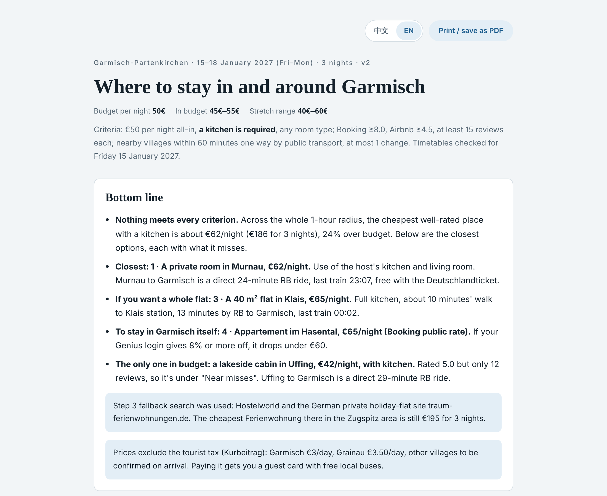
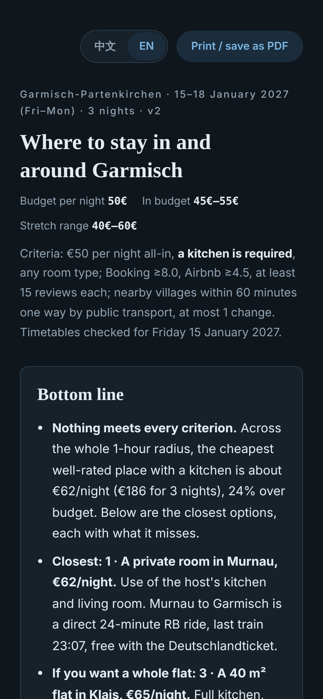

# Europe Town Stay Finder

**English** · [中文](README.zh-CN.md)

**An AI-agent skill that finds somewhere to stay in a small European town, plus the villages around it.** Small towns often have few beds, or none in budget. Villages 10–20 minutes away by train or bus usually have plenty. The skill maps every village within 1 hour by public transport (direct, or at most 1 change) and searches each one on Booking and Airbnb against your nightly budget and rating thresholds. If too few places qualify, it falls back to holiday-flat sites and local guesthouses. It also lists outdoor sports near the town (ski schools, climbing, paragliding, snowshoeing…) with instructors and groups, and the best-rated komoot hikes you can reach by bus. The result is one bilingual (中文 / English) comparison page.

It works with any AI agent that can browse the web: Claude, Claude Code, Cursor, Codex, ChatGPT, Gemini.

<p>
  
  
</p>

**Live example:** [Garmisch-Partenkirchen and around](https://htmlpreview.github.io/?https://github.com/JialiNong/europe-town-stay-finder-skill/blob/main/europe-town-stay-finder/examples/garmisch-2027-01.html) (the toggle at the top right switches between 中文 and English) · source data: [`garmisch-2027-01.json`](europe-town-stay-finder/examples/garmisch-2027-01.json)

---

## Why

Normally you'd flip between Booking, Airbnb, Google Maps and guesthouse sites, then check how often each village's train runs and when the last one leaves. Here's what one run found for Garmisch-Partenkirchen (15–18 January 2027, €50 a night, kitchen required):

- **12 villages within an hour**, including Ehrwald and Lermoos across the border in Austria, where the Deutschlandticket is still valid.
- **Last connections back:** Murnau and Uffing until 23:07, Klais and Mittenwald until 00:02, but Wallgau's last bus is 20:35.
- **The real market floor.** Booking, Airbnb and traum-ferienwohnungen.de all agreed that nothing well-rated with a kitchen went below about €62 a night. The closest was a private room in Murnau. The only in-budget place, a lakeside cabin in Uffing at €42, had just 12 reviews.
- **January activities:** ski schools, a beginner ski-touring course, cross-country skiing, snowshoe hikes, bouldering and tandem paragliding. Gorges closed in winter (Höllentalklamm, Geisterklamm) are flagged in the hike list.

## What it does

1. **Maps the 1-hour transit radius.** It lists villages on the same valley, rail line and bus routes, and checks travel time, changes, frequency, last ride back and fare for each. It also checks what the local guest card includes for free.
2. **Searches each village on Booking and Airbnb.** Thresholds: Booking ≥ 8.0, Airbnb ≥ 4.5, at least 15 reviews, and an all-in nightly price within ±20% of budget. A kitchen can be required.
3. **Falls back when fewer than 5 qualify:** Google Maps, tourist-office listings, holiday-flat platforms, local guesthouses and hostels.
4. **Outdoor sports** for the season: schools, guides, clubs and groups, with prices and how to book.
5. **komoot hikes**, picked by rating and number of ratings, checked for bus access to the start and for seasonal closures.
6. **Writes JSON** and renders it with a fixed template into a self-contained, bilingual HTML page. When coordinates are present it draws three maps (stays, sports, hikes).

## Design decisions

| Decision | Why |
|---|---|
| **The agent writes data, a fixed template renders the page** | The model only outputs JSON (validated against [`schema/stay.schema.json`](europe-town-stay-finder/schema/stay.schema.json)). [`template/render.js`](europe-town-stay-finder/template/render.js) computes the budget bands, "in budget / X% over" labels, the cheapest channel per stay and the cheapest in the table, so the model can't get the arithmetic wrong. |
| **Bilingual data model** | Any text field can be `"…"` or `{"zh": "…", "en": "…"}`. The toggle appears only when both languages exist, the choice persists, and `?lang=en` deep-links. |
| **Allowlisted HTML in text fields** | Listing descriptions and reviews come from the web. Only `<b> <i> <a> <br>`-style inline tags survive, links must be `http(s)`, and attributes are stripped. |
| **Self-drawn SVG maps** | Stay, activity and hike maps are drawn from coordinates in plain JS. They use an equirectangular projection with latitude correction, a scale bar and a north arrow, need no map library or tiles, and work offline and in print. |
| **Caps against noise** | At most 7 villages, 7 stays per village and 7 hikes, ranked by explicit rules, so the page stays readable. |
| **Preferences in `profile.md`** | "No car", rail passes and booking-platform membership change the answer (Booking member rates, walking distance to stations), so they're kept separate from the generic workflow. |

## Project structure

```
europe-town-stay-finder/        ← the skill itself (zip this folder to upload to Claude)
├── SKILL.md                    ← the workflow, steps 0–6 (written in Chinese; agents follow it in any language)
├── profile.md                  ← car or not, rail passes, booking memberships; edit this first
├── schema/stay.schema.json     ← JSON format, including bilingual text fields
├── template/
│   ├── shell.html
│   ├── style.css               ← light/dark themes, phone layout, print styles
│   └── render.js               ← renders the JSON in the browser (i18n, sanitiser, maps)
├── scripts/
│   ├── render.mjs              ← JSON → standalone HTML (Node 18+, no dependencies)
│   └── render.py               ← same, Python 3 standard library only
└── examples/
    ├── garmisch-2027-01.json   ← a real search, bilingual
    ├── garmisch-2027-01.html
    ├── demo-caps-mock.json     ← made-up data showing the caps and a single-language page
    └── demo-caps-mock.html

AGENTS.md                       ← entry point for Cursor / Codex / Gemini CLI
CLAUDE.md                       ← entry point for Claude Code (imports AGENTS.md)
GEMINI.md                       ← entry point for Gemini CLI
.cursor/rules/                  ← Cursor rule
.claude/skills/                 ← Claude Code project skill (symlink to europe-town-stay-finder/)
```

## Set up your profile

Open [`europe-town-stay-finder/profile.md`](europe-town-stay-finder/profile.md) and replace it with your own situation. It currently holds the author's: no car, a Deutschlandticket and BahnCard 25, and top-tier Booking Genius. The agent reads this file before every search.

## Usage

### Claude (claude.ai / desktop)

1. Zip the `europe-town-stay-finder/` folder (or run `npm run package`).
2. Upload the zip under **Settings → Skills**.
3. Say something like "Garmisch, 15–18 January, €50 a night, needs a kitchen". Claude does the research and publishes the page as an Artifact.

### Claude Code

```bash
git clone https://github.com/JialiNong/europe-town-stay-finder-skill
cd europe-town-stay-finder-skill
claude
```

`.claude/skills/europe-town-stay-finder` is picked up as a project skill. To use it everywhere, copy `europe-town-stay-finder/` to `~/.claude/skills/`.

### Cursor / Codex / Gemini CLI

Open the repo: these agents read `AGENTS.md` automatically. Cursor also reads `.cursor/rules/`, and Gemini CLI reads `GEMINI.md`. Results go to `stays/<town>-<date>.json` and `.html`. The agent needs web access, ideally with a browser tool, because Booking and Airbnb prices have to be read on the page.

### ChatGPT / Gemini (web)

1. Upload `SKILL.md`, `profile.md`, `schema/stay.schema.json` and `examples/garmisch-2027-01.json`, or add them to a GPT or Gem as knowledge.
2. Turn on web search and ask it to output JSON that follows the schema.
3. With a code interpreter, also upload `scripts/render.py` and the three `template/` files, then run `python3 render.py stay.json`. Without one, render locally:

```bash
node europe-town-stay-finder/scripts/render.mjs stay.json
# or
python3 europe-town-stay-finder/scripts/render.py stay.json
```

## Notes

- Prices, ratings and timetables are a snapshot from when the search ran. Platforms and operators are authoritative.
- The agent never books anything or fills in personal or payment details.
- `stays/` is git-ignored because your searches may contain personal details.

## Related skills

| Skill | What it answers |
|---|---|
| [europe-route-finder](https://github.com/JialiNong/europe-route-finder-skill) | How do I get there cheaply? Hub expansion, hidden direct trains and night trains, real fares compared across operators. |
| **europe-town-stay-finder** | Where do I stay around a small town, and what can I do outdoors? |
| [europe-city-culture-planner](https://github.com/JialiNong/europe-city-culture-planner-skill) | What do I do with my days in a big city: art, markets, architecture, viewpoints, walking tours, concerts and stand-up? |

## License

MIT
