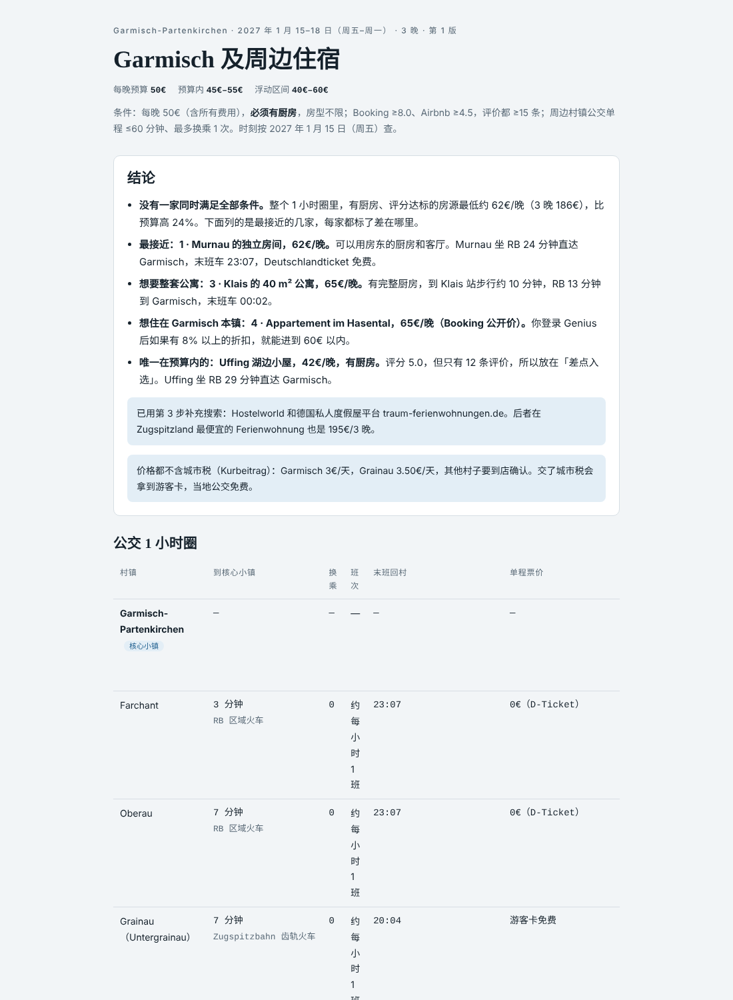
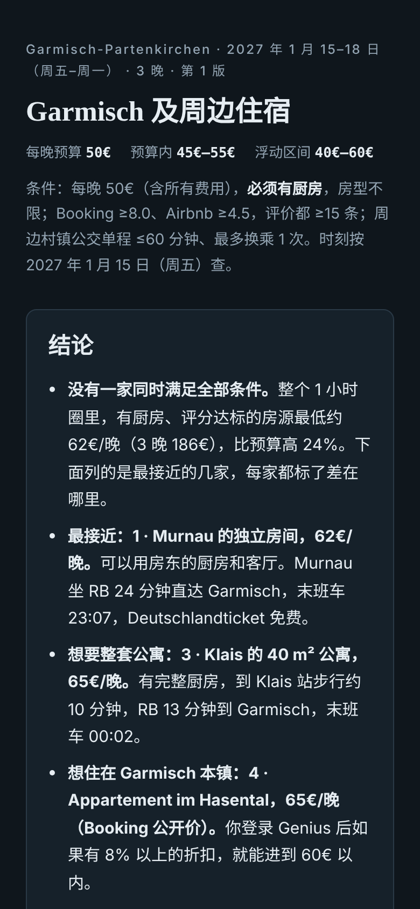

# Europe Town Stay Finder · 欧洲小镇住宿与周边玩法 skill

**让 AI agent 帮你在欧洲小镇找住宿**：不只搜你想去的那个小镇，而是把公交 1 小时内直达（最多换乘 1 次）的周边村镇一起搜，按你的每晚预算对比 Booking 和 Airbnb，不够再查度假屋平台和当地民宿；顺便整理小镇周边的户外运动（滑雪、攀岩、滑翔伞、雪鞋徒步……）的教练和团体，以及 komoot 上评分高、评价多的徒步路线。最后输出一张可以直接打开的对比页。

适用于 Claude、Claude Code、Cursor、Codex、ChatGPT、Gemini 等能上网的 AI agent。它和 [europe-route-finder](https://github.com/JialiNong/europe-route-finder-skill)（查怎么去）是一对：那个管路上，这个管到了以后住哪、玩什么。

<p>
  
  
</p>

示例：[`europe-town-stay-finder/examples/garmisch-2027-01.html`](europe-town-stay-finder/examples/garmisch-2027-01.html)（下载后用浏览器打开）

---

## 为什么需要它

想去的小镇常常住宿少、或者超预算，但它周边坐火车或公交十几分钟的村子也有很多住宿。平时要在 Booking、Airbnb、Google 地图和各家官网之间来回对比，还要自己查每个村子的车有多少班、末班车几点。

以 Garmisch-Partenkirchen 为例（2027 年 1 月 15–18 日，每晚 50€、必须有厨房）：

- 圈出了 12 个周边村镇：Farchant、Grainau、Murnau、Uffing、Klais、Mittenwald、Wallgau，连奥地利的 Ehrwald、Lermoos（Deutschlandticket 在这段有效）都在 1 小时内。
- 查了每个村子到 Garmisch 的车型、时长、末班车：Murnau、Uffing 的 RB 末班 23:07，Klais、Mittenwald 到 00:02，Wallgau 的公交 20:35 就停了。
- Booking、Airbnb、traum-ferienwohnungen.de 都说明同一件事：这几天有厨房、评分达标的住宿最低约 62€/晚。最接近的是 Murnau 的独立房间（62€，可用房东厨房）；唯一在预算内的是 Uffing 湖边小屋（42€），但只有 12 条评价。
- 1 月能做的运动：滑雪学校、滑雪登山入门课、越野滑雪、雪鞋徒步、抱石馆、滑翔伞双人飞行。komoot 高分路线里标出了冬季关闭的峡谷（Höllentalklamm、Geisterklamm）。

## 它会做什么

1. **画出公交 1 小时圈**：列出同一山谷、同一铁路线和公交线上的村镇，逐个查时长、换乘、班次、末班车、票价，以及游客卡包含哪些免费交通和活动。
2. **逐村搜 Booking 和 Airbnb**：Booking ≥8.0、Airbnb ≥4.5，评价都 ≥15 条，每晚总价（含所有费用）在预算 ±20% 内；可以要求必须有厨房。
3. **不够 5 家就补充搜索**：Google 地图、旅游局住宿目录、度假屋平台、当地民宿和青旅。
4. **户外运动**：按季节列出滑雪、攀岩、滑翔伞、徒步等，找到教练、学校和团体，附价格和预约方式。
5. **komoot 徒步路线**：按评分和评分人数挑，检查起点能不能坐公交到，标出季节限制。
6. **输出对比页**：agent 只写一份 JSON，由固定模板渲染成页面，省 token，页面每次都一样整齐。有坐标数据时页面会自动画住宿、户外运动、komoot 路线三张地图；页面右上角还有「导出 / 打印 PDF」按钮，用浏览器自带的打印功能存成 PDF。

## 项目结构

```
europe-town-stay-finder/        ← skill 本体（可以整个文件夹打包上传到 Claude）
├── SKILL.md                    ← 完整流程：第 0–6 步
├── profile.md                  ← 你的个人设置（有没有车、车票、订房会员），先改这个
├── schema/stay.schema.json     ← JSON 的格式
├── template/                   ← 固定页面模板
│   ├── shell.html
│   ├── style.css               ← 浅色/深色主题、手机适配
│   └── render.js               ← 在浏览器里把 JSON 渲染成对比页
├── scripts/
│   ├── render.mjs              ← JSON → 独立 HTML（Node 18+，无依赖）
│   └── render.py               ← 同上（Python 3，只用标准库）
└── examples/
    ├── garmisch-2027-01.json   ← 真实查询的结果
    └── garmisch-2027-01.html

AGENTS.md                       ← Cursor / Codex / Gemini CLI 等会自动读的入口
CLAUDE.md                       ← Claude Code 的入口（引用 AGENTS.md）
GEMINI.md                       ← Gemini CLI 的入口
.cursor/rules/                  ← Cursor 规则
.claude/skills/                 ← Claude Code 项目 skill（链接到 europe-town-stay-finder/）
```

## 先改个人设置

打开 [`europe-town-stay-finder/profile.md`](europe-town-stay-finder/profile.md)，换成你自己的情况。现在里面是作者的设置：没有车、有 Deutschlandticket 和 BahnCard 25、Booking 最高等级 Genius 会员。agent 每次查之前都会先读这个文件。

## 怎么用

### Claude（claude.ai / 桌面端）

1. 下载仓库，把 `europe-town-stay-finder/` 文件夹打成 zip（或运行 `npm run package`）。
2. 在 Claude 的 **设置 → Skills（技能）** 里上传这个 zip。
3. 对 Claude 说：「我想去 Garmisch，1 月 15–18 日，每晚 50 欧，要有厨房」。Claude 查完会把页面发布成 Artifact。

### Claude Code

```bash
git clone https://github.com/JialiNong/europe-town-stay-finder-skill
cd europe-town-stay-finder-skill
claude
```

仓库里的 `.claude/skills/europe-town-stay-finder` 会被识别为项目 skill。想在所有项目里都能用，把 `europe-town-stay-finder/` 复制到 `~/.claude/skills/`。

### Cursor / Codex / Gemini CLI

用这个仓库打开项目即可：它们会自动读 `AGENTS.md`（Cursor 还会读 `.cursor/rules/`，Gemini CLI 读 `GEMINI.md`）。结果存到 `stays/<小镇>-<日期>.json` 和 `.html`。这些 agent 需要能上网，最好有浏览器工具（Booking 和 Airbnb 的价格要在页面上看）。

### ChatGPT / Gemini（网页版）

1. 把 `SKILL.md`、`profile.md`、`schema/stay.schema.json`、`examples/garmisch-2027-01.json` 上传到对话（或放进 GPT / Gem 的知识库）。
2. 打开联网搜索，让它查完后按 schema 输出 JSON。
3. 有代码解释器时，再上传 `scripts/render.py` 和 `template/` 里的三个文件，让它运行 `python3 render.py stay.json` 生成 HTML；没有的话把 JSON 存下来在本地渲染：

```bash
node europe-town-stay-finder/scripts/render.mjs stay.json
# 或
python3 europe-town-stay-finder/scripts/render.py stay.json
```

## 页面模板

- 住宿编号按 `stays` 的顺序自动生成。
- 预算区间（预算内 ±10%、浮动 ±20%）、每家的「预算内 / 超预算 X%」标签、每家最便宜的渠道、总览表里的最低价都自动计算。
- 浅色/深色主题跟随系统，手机上表格可以左右滑动。
- 生成的 HTML 是单个文件，可以直接发给别人。

想改样式时改 `template/style.css` 或 `template/render.js`，然后运行 `npm run example` 检查一遍。

## 注意

- 价格、评分、时刻都是查询时的快照，以平台和运营方为准。
- agent 不会替你下单，也不会填写任何个人或支付信息。
- `stays/` 默认不提交到 git，里面可能有你的行程信息。

## License

MIT
